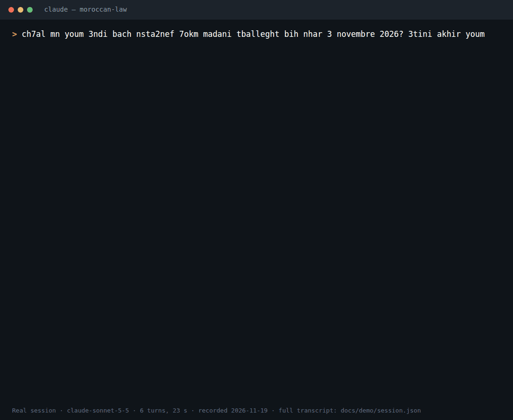

# moroccan-law

[English](README.md) · **العربية** · [Français](README.fr.md)

<div dir="rtl">

**القانون المغربي لـ Claude ولأي ذكاء اصطناعي، انطلاقا من النصوص الرسمية.** يطرح المحامي سؤاله بالعربية أو الفرنسية
أو الدارجة، فيفتح Claude النص الرسمي ويستشهد بالمادة حرفيا مع رقمها وتاريخ الصيغة المحينة ورابط
ملف PDF الأصلي. لا يجيب من الذاكرة.
**813 نصا و41,410 مادة**: مهارات Claude، وخادم MCP لأي تطبيق ذكاء اصطناعي، ومجموعة بيانات مفتوحة.



التسجيل تشغيل حقيقي وليس نموذجا مصطنعا ([النص الكامل للجلسة](docs/demo/session.json)).

## هل يغير شيئا؟ بالقياس

100 سؤال من نوع «أكمل الفراغ» مولدة آليا من النصوص (يحذف رقم من جملة، وعلى النموذج أن يعطي
الرقم ورقم المادة)، بالنموذج نفسه مع الإضافة وبدونها:

| Claude Sonnet 5.5، 100 سؤال، تشغيل واحد لكل سؤال | مع الإضافة | بدونها |
|---|---|---|
| الرقم **و** رقم المادة صحيحان | **95%** | 7% |
| الرقم صحيح | 100% | 48% |
| رقم المادة صحيح | 95% | 9% |

هذا يقيس العثور على المقتضى الصحيح والاستشهاد به، لا الاستدلال القانوني. المنهجية والتفصيل حسب
المجال والحدود في [evals/RESULTS.md](evals/RESULTS.md) (بالإنجليزية).

## المحتوى

- **16 مهارة، 95 نصا، 19,423 مادة** من 6,407 صفحة من ملفات PDF الرسمية المنشورة في
  بوابة [عدالة](https://adala.justice.gov.ma) لوزارة العدل: 77 نصا بالعربية (وهي اللغة المعتمدة)،
  و15 نسخة فرنسية، و3 نصوص منسوخة محتفظ بها للمقارنة.
- **مدونة موسعة من 718 قانونا آخر** (`maroc-corpus`، 21,987 مادة، 9,003 صفحة): الصحة والتعليم
  والوظيفة العمومية والفلاحة والانتخابات والأمن والشؤون الدينية والصناعة والطاقة والجماعات
  الترابية والمؤسسات الدستورية… بنفس الاستخراج والبحث مادة بمادة، لكن **دون مراجعة نصا نصا**،
  بل بمراقبة آلية. من أصل 824 قانونا استُبعد 106 مع ذكر السبب (`data/corpus-excluded.json`):
  لا توجد مادة (60، أغلبها ظهائر تعيين)، بنية غير مستخرجة (26)، أرقام مشوهة بسبب الخط تكشفها
  تواريخ مستحيلة مثل «62 شتنبر» (14)، حروف مقروءة أرقاما أو رسوم معطوبة (5)، جدول مبالغ مدموجة (1). المقارنة كلمة بكلمة مع مستخرجين آخرين: 99.76% من 1.5 مليون كلمة مؤكدة (`data/crosscheck-corpus.json`).
  المجموع: **813 نصا و41,410 مادة** قابلة للبحث مادة بمادة.
- **فهرس يضم 7,150 وثيقة رسمية** (6,508 بالعربية و642 بالفرنسية): قوانين وظهائر ومراسيم
  وقرارات ومناشير الوزارة واتفاقيات دولية وقرارات المحكمة الدستورية. يبحث فيه Claude ويحمل ملف
  PDF الرسمي لأي منها.
- **أدوات عملية** (مهارة المسطرة المدنية):
  - `delais.py` يحسب الأجل وفق المادة 602 من القانون رقم 58.25، مع أيام الأعياد المحددة في
    المرسوم رقم 2.77.169؛
  - `compare.py` يقابل فصلا من قانون المسطرة المدنية القديم (1974) بأقرب مادة إليه في القانون
    رقم 58.25 (تشابه لفظي محسوب آليا، وليس جدول مقابلة رسميا)؛
  - ثلاثة نماذج مقالات (افتتاحي، استئنافي، نقض) كل بيان إلزامي فيها مقرون بمادته.
- **خادم MCP** (`mcp/server.py`، بدون أي اعتماديات) لاستعمال النصوص نفسها في Claude Desktop
  و Cursor و VS Code وأي برنامج يدعم MCP.
- **مصدر كل نص موثق**: الرابط الرسمي، تاريخ التحديث في البوابة، تاريخ الصيغة المحينة المطبوع في
  الملف، بصمة SHA-256، تاريخ الاستخراج، وما رصد من شذوذ أثناء المعالجة.

| المهارة | المجال | النصوص العربية (عدد المواد) | نسخ فرنسية |
|---|---|---|---|
| `maroc-droit` | القانون المغربي — الفهرس العام | دستور المملكة المغربية لسنة 2011 (180) | 1 |
| `maroc-civil` | القانون المدني المغربي | قانون الالتزامات والعقود (1316); القانون رقم 95.17 المتعلق بالتحكيم والوساطة الاتفاقية (105) | 2 |
| `maroc-procedure-civile` | المسطرة المدنية والتنظيم القضائي | القانون رقم 58.25 المتعلق بالمسطرة المدنية (644); القانون رقم 38.15 المتعلق بالتنظيم القضائي (111); القانون رقم 42.10 المتعلق بتنظيم قضاء القرب (22); المرسوم رقم 2.77.169 بتحديد لائحة أيام الأعياد المسموح فيها بالعطلة في الإدارات العمومية (3); الظهير الشريف بشأن استعمال الإكراه البدني في القضايا المدنية (3)<br>*منسوخة، للمقارنة:* [منسوخ — للمقارنة فقط] قانون المسطرة المدنية القديم (الظهير الشريف بمثابة قانون رقم 1.74.447) (471); [منسوخ — للمقارنة فقط] القانون رقم 41.90 المحدث بموجبه محاكم إدارية (47); [منسوخ — للمقارنة فقط] القانون رقم 53.95 القاضي بإحداث المحاكم التجارية (25) | — |
| `maroc-penal` | القانون الجنائي المغربي | مجموعة القانون الجنائي (731); القانون المتعلق بالعقوبات البديلة (4); القانون المتعلق بمحاربة العنف ضد النساء (18); القانون المتعلق بمكافحة غسل الأموال (43); القانون المتعلق بزجر الإدمان على المخدرات السامة (16); القانون رقم 02.03 المتعلق بدخول وإقامة الأجانب بالمملكة المغربية وبالهجرة غير المشروعة (58) | 1 |
| `maroc-procedure-penale` | المسطرة الجنائية | القانون المتعلق بالمسطرة الجنائية (917) | — |
| `maroc-famille` | قانون الأسرة المغربي | مدونة الأسرة (400); القانون رقم 36.21 المتعلق بالحالة المدنية (59); القانون رقم 15.01 المتعلق بكفالة الأطفال المهملين (32); قانون الجنسية المغربية (46) | 2 |
| `maroc-travail` | قانون الشغل والحماية الاجتماعية | مدونة الشغل (القانون رقم 65.99) (589); القانون المتعلق بالتعويض عن حوادث الشغل (197); القانون المتعلق بنظام الضمان الاجتماعي (92); القانون رقم 65.00 بمثابة مدونة التغطية الصحية الأساسية (154); القانون التنظيمي رقم 97.15 بتحديد شروط وكيفيات ممارسة حق الإضراب (33); الظهير الشريف بشأن النقابات المهنية (27) | 1 |
| `maroc-commerce` | القانون التجاري وقانون الشركات | مدونة التجارة (القانون رقم 15.95) (849); القانون رقم 17.95 المتعلق بشركات المساهمة (461); القانون رقم 5.96 المتعلق بشركة التضامن والشركة ذات المسؤولية المحدودة وباقي الشركات (147); القانون المتعلق بحرية الأسعار والمنافسة (114); القانون القاضي بتحديد تدابير لحماية المستهلك (206); القانون رقم 112.12 المتعلق بالتعاونيات (108) | 4 |
| `maroc-immobilier` | القانون العقاري والكراء | القانون رقم 39.08 المتعلق بمدونة الحقوق العينية (334); ظهير التحفيظ العقاري (134); القانون رقم 18.00 المتعلق بنظام الملكية المشتركة للعقارات المبنية (101); القانون المتعلق بتنظيم العلاقات التعاقدية بين المكري والمكتري للمحلات المعدة للسكنى أو للاستعمال المهني (75); القانون المتعلق بكراء العقارات أو المحلات المخصصة للاستعمال التجاري أو الصناعي أو الحرفي (38); القانون المتعلق بكيفية مراجعة أثمان الكراء (10); القانون رقم 7.81 المتعلق بنزع الملكية لأجل المنفعة العامة (70); القانون رقم 12.90 المتعلق بالتعمير (97); القانون رقم 25.90 المتعلق بالتجزئات العقارية والمجموعات السكنية وتقسيم العقارات (96); القانون رقم 51.00 المتعلق بالإيجار المفضي إلى تملك العقار (23); مدونة الأوقاف (177) | 3 |
| `maroc-professions-judiciaires` | مهنة المحاماة والمهن القضائية | القانون رقم 66.23 المتعلق بتنظيم مهنة المحاماة (147); القانون رقم 32.09 المتعلق بتنظيم مهنة التوثيق (134); القانون رقم 51.26 المتعلق بتنظيم مهنة العدول (204); القانون رقم 46.21 المتعلق بتنظيم مهنة المفوضين القضائيين (175); القانون رقم 01.24 المتعلق بالخبراء القضائيين (77); القانون التنظيمي رقم 100.13 المتعلق بالمجلس الأعلى للسلطة القضائية (121); القانون التنظيمي رقم 106.13 المتعلق بالنظام الأساسي للقضاة (118) | — |
| `maroc-administratif` | القانون الإداري والصفقات العمومية | القانون رقم 03.01 بشأن إلزام الإدارات بتعليل قراراتها الإدارية (7); القانون رقم 80.03 المحدثة بموجبه محاكم استئناف إدارية (21); القانون رقم 55.19 المتعلق بتبسيط المساطر والإجراءات الإدارية (33); القانون رقم 54.19 بمثابة ميثاق المرافق العمومية (38); المرسوم رقم 2.22.431 المتعلق بالصفقات العمومية (170); القانون التنظيمي رقم 113.14 المتعلق بالجماعات (283); القانون رقم 62.99 المتعلق بمدونة المحاكم المالية (252); القانون رقم 11.03 المتعلق بحماية واستصلاح البيئة (80); القانون رقم 36.15 المتعلق بالماء (164); القانون المتعلق برهن الصفقات العمومية (15) | — |
| `maroc-fiscal-douane` | الجمارك وتحصيل الديون العمومية والجبايات | مدونة الجمارك والضرائب غير المباشرة (الظهير الشريف رقم 1.77.339) (312); القانون رقم 15.97 بمثابة مدونة تحصيل الديون العمومية (152); القانون الإطار رقم 69.19 المتعلق بالإصلاح الجبائي (19) | — |
| `maroc-numerique` | المعطيات الشخصية والمعاملات الإلكترونية والأمن السيبراني | القانون رقم 09.08 المتعلق بحماية الأشخاص الذاتيين تجاه معالجة المعطيات ذات الطابع الشخصي (67); القانون رقم 53.05 المتعلق بالتبادل الإلكتروني للمعطيات القانونية (4); القانون رقم 43.20 المتعلق بخدمات الثقة بشأن المعاملات الإلكترونية (84); القانون رقم 05.20 المتعلق بالأمن السيبراني (53) | 1 |
| `maroc-assurances-banques` | التأمينات والأبناك | القانون رقم 17.99 المتعلق بمدونة التأمينات (408); الظهير الشريف رقم 1.84.177 المتعلق بتعويض المصابين في حوادث تسببت فيها مركبات برية ذات محرك (32); القانون رقم 103.12 المتعلق بمؤسسات الائتمان والهيئات المعتبرة في حكمها (233); القانون رقم 40.17 المتعلق بالقانون الأساسي لبنك المغرب (81); القانون رقم 52.05 المتعلق بمدونة السير على الطرق (329) | — |
| `maroc-propriete-intellectuelle` | الملكية الفكرية والصناعية | القانون رقم 17.97 المتعلق بحماية الملكية الصناعية (293); القانون رقم 2.00 المتعلق بحقوق المؤلف والحقوق المجاورة (124) | — |
| `maroc-libertes-publiques` | الحريات العامة والصحافة | الظهير الشريف رقم 1.58.376 بتنظيم حق تأسيس الجمعيات (36); الظهير الشريف رقم 1.58.377 بشأن التجمعات العمومية (26); القانون رقم 88.13 المتعلق بالصحافة والنشر (126); القانون رقم 31.13 المتعلق بالحق في الحصول على المعلومات (30) | — |
| `maroc-corpus` | باقي القوانين المغربية (استخراج آلي) | 718 قانونا وظهيرا (21,987 مادة)، استخراج آلي بمراقبة آلية؛ البحث عنها بـ `law.py find` | — |

جلبت النصوص والفهرس بتاريخ 2026-11-19. تاريخ كل صيغة محينة مذكور في ملف `SKILL.md` لكل مهارة.

## التثبيت

**Claude Code** (إضافة):

</div>

```text
/plugin marketplace add Med-kr/moroccan-law
/plugin install moroccan-law@moroccan-law
```

<div dir="rtl">

أو بدون نظام الإضافات: `git clone` ثم `./install.sh`.

**أي ذكاء اصطناعي آخر** (ChatGPT وGemini وCopilot وCursor وWindsurf وCodex وLM Studio…): نفس النصوص
عبر خادم MCP (محليا أو عبر HTTP) أو مجموعة البيانات `exports/moroccan-law-articles.jsonl.gz`
(41,410 مادة، كل مادة في سطر JSON). طريقة التثبيت في كل تطبيق: [docs/USE_WITH_ANY_AI.md](docs/USE_WITH_ANY_AI.md).

**Claude Desktop و Cursor وباقي برامج MCP**: انسخ المستودع وأضف إلى إعدادات MCP:

</div>

```json
{ "mcpServers": { "moroccan-law": { "command": "python3", "args": ["/absolute/path/to/moroccan-law/mcp/server.py"] } } }
```

<div dir="rtl">

كل ما يشغله المستعمل مكتوب بـ Python 3.10 فما فوق بدون أي مكتبة إضافية.

## ما مدى دقة النص؟

النصوص مستخرجة من ملفات PDF ببرنامج، ولذلك تُراقَب ببرامج، بأربع طرق
(`scripts/crosscheck.py`، والنتائج في `data/crosscheck.json`):

| المراقبة | العربية (80 نصا) | الفرنسية (15 نصا) |
|---|---|---|
| كلمات قورنت بمستخرج ثان (poppler) | 943,756 | 317,801 |
| كلمات ينتجها المستخرج الثاني أيضا | 99.88% | 99.98% |
| كلمات لم يجدها أي من المستخرجين الآخرين (poppler و MuPDF) | 301 | 0 |
| أرقام قورنت (آجال، مبالغ، أرقام مواد وقوانين) | 48,758 | 17,369 |
| أرقام لم يجدها كما هي أي مستخرج آخر | 5 | 1 |
| الهوامش المحتفظ بها (كلها مطبوعة) | 3,979 | 1,202 |

- الكلمات الـ 301 قُرئت واحدة واحدة: كلمات عادية يقطعها المستخرجان الآخران إلى جزأين. ومن
  الأرقام الستة، 4 أرقام ظهائر يعيد المشروع ترتيبها عمدا (انظر أسفله).
- **حروف خاطئة في خطوط المصدر.** ملف PDF يحدد الحرف الذي يمثله كل رسم، وبرنامج Word يسجل
  أحيانا حرفا خاطئا، فتقرأ كل المستخرجات الحرف الخاطئ نفسه. لذلك يقارن البناء كل خط بالخط نفسه
  في الملفات الـ 78 الأخرى (`scripts/glyph_table.py`) ويصحح الشاذ: 20 رسما في 15 نصا، مثل
  «آ» مقروءة «ا» في قانون المسطرة المدنية، و«ج» مقروءة «و» في قانون الصحافة، والكشيدة مقروءة
  «د» في مرسوم الصفقات العمومية.
- **أرقام مطبوعة معكوسة في المصدر.** أرقام ظهائر ومراسيم مطبوعة معكوسة (36 مرة) في ملف PDF الرسمي نفسه
  («11.03.1» بدل 1.11.03)، وقد أعيد ترتيبها.
- عدد المواد متطابق بين الصيغتين العربية والفرنسية للمدونات التي تتوفر على الصيغتين (الالتزامات والعقود 1316، الأسرة 400،
  الشغل 589، الحقوق العينية 334، الدستور 180).

- **كل ملاحظة يتركها المحلل روجعت** (`scripts/review_anomalies.py`): من أصل 105 ملاحظة، 75 مادة
  منسوخة يشرحها هامش في النص، و22 مواد من قانون المسطرة الجنائية مقتبسة في القانون الذي أدرجها،
  و8 قُرئت يدويا مع تدوين السبب.
- **أخطاء مطبوعة في الملف الرسمي نفسه** لا تصحح إلا بتصويب موثق (`countries/ma/errata.json`)،
  مثل تبادل عنواني المادتين 353 و353 المكررة في النسخة الفرنسية لقانون شركات المساهمة. ويظهر
  الاختلاف بين النسختين الرسميتين تحت المادة نفسها: المادة 256 من مدونة الشغل واردة في النسخة
  العربية ومشار إلى نسخها في النسخة الفرنسية.
- **التعديلات**: كل قانون معدِّل مدرج في البوابة مذكور في النص المحين الذي يعدله
  (`scripts/freshness.py`، صفر ناقص).

84 اختبارا آليا (Python 3.10 و3.12 و3.13).

## مجموعة أسئلة قانونية

40 سؤالا من أسئلة الممارسين (بالدارجة والفرنسية والعربية) في المجالات الـ16 (`evals/legal/`)،
بدون نموذج وبدون كلفة: الجواب المنتظر موجود فعلا في المادة المنتظرة (**40/40**)، والبحث الذي
يكتبه مستعمل متأن يجد تلك المادة ضمن النتائج الخمس الأولى (**40/40**، و34/40 في المرتبة الأولى). ولأن هذه المجموعة استعملت لتحسين البحث، كُتب بعدها 20 سؤالا
جديدا لم تستعمل قط في الضبط (`holdout.json`): الجواب في المادة **20/20** (بعد تصحيح خمسة أجوبة
أخرى من الذاكرة انطلاقا من النصوص، مثلا أجل التعرض خمسة عشر يوما، المادة 200 من القانون 58.25)،
والمادة الصحيحة ضمن الخمس الأولى **17/20**، وفي المرتبة الأولى **13/20**. هذا هو الرقم الصادق لبحث
واحد، وClaude يجري عادة عدة أبحاث. ومجموعة ثالثة من 40 سؤالا (`holdout2.json`) كتبت قبل جولة ثانية من
التحسينات وقيست مرة واحدة بعدها: ضمن الخمس الأولى **31/40** قبل وبعد، وفي المرتبة الأولى من 22 إلى 23/40.
البحث بالكلمات بلغ سقفه، والخطوة التالية هي البحث الدلالي.
كشفت كتابة المجموعة جوابين مكتوبين من الذاكرة تخالفهما النصوص: الحضانة تستمر إلى سن الرشد
القانوني، والخامسة عشرة هي سن الاختيار (المادة 166 من مدونة الأسرة)؛ والتصريح بحادثة الشغل
يتم خلال خمسة أيام (المادة 15 من القانون 18.12). وأعيد بناء البحث على هذه الأسئلة (ترتيب حسب
الصلة، أداة التعريف وحروف الجر المتصلة، الهمزات، العناوين، مرادفات فقهية متحقق منها في النصوص).
هذا يقيس النصوص والبحث، لا الاستدلال القانوني: [docs/LAWYER_REVIEW.md](docs/LAWYER_REVIEW.md)
ورقة ليقيّم محام ممارس أجوبة Claude.

**هذه ليست شهادة.** لا توجد مراقبة آلية تثبت أن 1.1 مليون كلمة كلها صحيحة. الصحيح هو أن كل
مراقبة أجريت على كل نص، وأن كل خلل وُجد أُصلح من أصله وله اختبار، وأن الفروق الباقية قُرئت.
في كل ما له أهمية، قارن مع ملف PDF (رابطه في رأس كل نص) ومع الجريدة الرسمية.

## الحدود

- **استخراج آلي.** بعض الكلمات فيها فراغ زائد، والجداول مبسطة، وبعض العناوين بقيت نصا عاديا
  (مدرجة تحت `anomalies` في كل `meta.json`). قبل أي إيداع بالمحكمة، يجب مراجعة الاستشهاد على
  ملف PDF الرسمي أو الجريدة الرسمية.
- **النسخ الفرنسية أقدم في الغالب** من العربية (مدونة الشغل بالفرنسية: 2011؛ بالعربية: 2026)،
  وهي موسومة بذلك. المرجع هو النص العربي.
- **الاجتهاد القضائي**: قرارات المحكمة الدستورية فقط، ملفات PDF عبر الفهرس. البوابة الرسمية للمجلس
  الأعلى للسلطة القضائية (juriscassation.cspj.ma، حوالي 52 ألف قرار لمحكمة النقض) تطلب رمز
  تأكيد قبل عرض القرار، فلا تُجمع آليا: المهارات توجه المستعمل إليها بكلمات بحث عربية وتحلل
  القرار الذي يلصقه في المحادثة، ولا تستشهد أبدا بقرار من الذاكرة.
- **غير منشورة في البوابة فهي غير موجودة هنا**: المدونة العامة للضرائب (موقع المديرية العامة
  للضرائب يرفض الولوج الآلي). قوانين المالية موجودة في البوابة بعمودين على شكل الجريدة الرسمية؛
  صار المستخرج يقرأ العمودين بالترتيب، لكن خطوط هذه الملفات تربط حروفا بأرقام («ك» تقرأ «6» و«ر»
  تقرأ «7»، 291 مرة في قانون 2026)، فقد تكون النسب والمبالغ خاطئة، ولذلك استُبعدت.
- **محينة إلى تاريخ البناء.** إجراء أسبوعي على GitHub يحدث الفهرس ويفتح تنبيها عند تعويض نص؛
  جرب محليا ولم يشتغل بعد على GitHub.
- **الآجال**: `delais.py` يطبق المادة 602 من القانون 58.25 والأعياد ذات التاريخ الثابت في المرسوم
  2.77.169 والمادة 639 (تعذر الولوج إلى المنصة في اليوم الأخير). الأعياد الدينية تقديرية وتعطي
  تنبيها فقط (رؤية الهلال هي الفيصل). وسريان الأجل من جديد بعد الوقف (المادة 212: تغير الأهلية؛ المادة 380: المساعدة القضائية) يحسب بـ `--restart`.
- **تطبيق القانون من حيث الزمان**: `law.py transitional <النص>` يعرض الأحكام الانتقالية والختامية،
  والمهارات ملزمة بقراءتها إذا كانت الوقائع سابقة على إصلاح.

## دول أخرى

سلسلة البناء غير خاصة بالمغرب: كل دولة مجلد تحت `countries/`. المغرب هو الدولة الوحيدة المنجزة
حاليا. انظر [docs/ADDING_A_COUNTRY.md](docs/ADDING_A_COUNTRY.md).

## تنبيه

أداة مساعدة على البحث والتحرير موجهة لمهنيي القانون. ليست استشارة قانونية ولا تعوض المحامي.
المشروع مستقل ولا علاقة له بوزارة العدل ولا بالأمانة العامة للحكومة ولا بشركة Anthropic. المصدر
الرسمي الوحيد للقانون المغربي هو الجريدة الرسمية.

الشيفرة والوثائق: رخصة [MIT](LICENSE). النصوص القانونية نصوص رسمية للمملكة المغربية منقولة عن
بوابة عدالة، ولا يدعي المشروع أي حق عليها.

</div>
