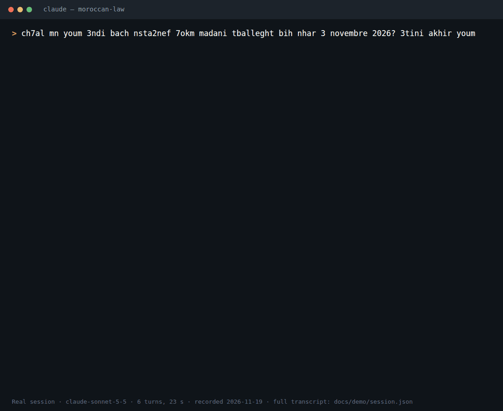

# moroccan-law

[English](README.md) · [العربية](README.ar.md) · **Français**

**Le droit marocain pour Claude et toute IA, à partir des textes officiels.** L'avocat pose sa question en
arabe, en français ou en darija ; Claude ouvre le texte officiel, cite l'article mot pour mot avec
son numéro, la date de la version et le lien vers le PDF source. Il ne répond pas de mémoire.
**813 textes, 41 410 articles** : skills Claude, serveur MCP pour toute application d'IA, jeu de données ouvert.



L'enregistrement est une exécution réelle ([transcription](docs/demo/session.json)).

## Est-ce que cela change quelque chose ? Mesuré

100 questions à trou générées à partir des textes (un chiffre retiré d'une phrase ; le modèle
doit donner le chiffre et le numéro de l'article), même modèle avec et sans le plugin :

| Claude Sonnet 5.5, 100 questions, 1 exécution chacune | Avec le plugin | Sans |
|---|---|---|
| Chiffre **et** numéro d'article exacts | **95 %** | 7 % |
| Chiffre exact | 100 % | 48 % |
| Numéro d'article exact | 95 % | 9 % |

Cela mesure la capacité à retrouver et citer la bonne disposition, pas le raisonnement juridique.
Méthode, détail par domaine et limites : [evals/RESULTS.md](evals/RESULTS.md) (en anglais).

## Contenu

- **16 skills, 95 textes, 19,423 articles** issus de 6,407 pages de PDF officiels
  publiés par le ministère de la Justice ([Adala](https://adala.justice.gov.ma)) : 77 textes en
  arabe (langue faisant foi), 15 versions françaises, 3 textes abrogés conservés pour comparaison.
- **Un corpus étendu de 718 autres lois** (`maroc-corpus`, 21,987 articles, 9,003 pages) :
  santé, enseignement, fonction publique, agriculture, élections, sécurité, affaires religieuses,
  industrie, énergie, collectivités territoriales, institutions constitutionnelles… Même
  extraction, recherche article par article, mais **pas de relecture texte par texte** : des
  contrôles automatiques à la place. Sur 824 lois, 106 ont été écartées avec leur motif
  (`data/corpus-excluded.json`) : aucun article (60, surtout des dahirs de nomination), structure
  non reconnue (26), chiffres altérés par la police, repérés par des dates impossibles comme
  « 62 septembre » (14), lettres lues comme des chiffres ou glyphes cassés (5), tableau de montants fusionnés (1). Comparaison mot à mot avec deux autres extracteurs : 99,76 % de 1,5 million de mots confirmés (`data/crosscheck-corpus.json`).
  Au total : **813 textes, 41,410 articles** consultables article par article.
- **Un catalogue de 7,150 documents officiels** (6,508 en arabe, 642 en français) : lois,
  dahirs, décrets, arrêtés, circulaires du ministère, conventions internationales, décisions de la
  Cour constitutionnelle. Claude y cherche et télécharge le PDF officiel.
- **Outils pour la pratique** (skill de procédure civile) :
  - `delais.py` calcule un délai selon l'article 602 de la loi 58-25, avec les jours fériés du
    décret 2-77-169 ;
  - `compare.py` rapproche un article de l'ancien code de 1974 de l'article le plus proche de la
    loi 58-25 (similarité textuelle calculée, pas une table officielle) ;
  - trois trames d'actes en arabe où chaque mention obligatoire renvoie à son article.
- **Un serveur MCP** (`mcp/server.py`, sans dépendance) pour Claude Desktop, Cursor, VS Code et
  tout client MCP.
- **La provenance de chaque texte** : URL source, date de mise à jour sur le portail, date de
  consolidation imprimée dans le PDF, SHA-256 du PDF, date d'extraction, anomalies relevées.

| Skill | Domaine | Textes arabes (articles) | Versions françaises |
|---|---|---|---|
| `maroc-droit` | Droit marocain — catalogue général | Constitution du Royaume du Maroc (2011) (180) | 1 |
| `maroc-civil` | Droit civil marocain | Dahir formant code des obligations et des contrats (DOC) (1316); Loi 95-17 relative à l'arbitrage et à la médiation conventionnelle (105) | 2 |
| `maroc-procedure-civile` | Procédure civile et organisation judiciaire | Loi 58-25 relative à la procédure civile (644); Loi 38-15 relative à l'organisation judiciaire (111); Loi 42-10 relative aux juridictions de proximité (22); Décret 2-77-169 fixant la liste des jours fériés dans les administrations publiques (3); Dahir relatif à l'exercice de la contrainte par corps en matière civile (3)<br>*Abrogés, pour comparaison :* [ABROGÉ — pour comparaison uniquement] Ancien code de procédure civile (dahir portant loi 1-74-447) (471); [ABROGÉ — pour comparaison uniquement] Loi 41-90 instituant des tribunaux administratifs (47); [ABROGÉ — pour comparaison uniquement] Loi 53-95 instituant des juridictions de commerce (25) | — |
| `maroc-penal` | Droit pénal marocain | Code pénal (731); Loi relative aux peines alternatives (4); Loi relative à la lutte contre les violences faites aux femmes (18); Loi relative à la lutte contre le blanchiment de capitaux (43); Dahir relatif à la répression de la toxicomanie (16); Loi 02-03 relative à l'entrée et au séjour des étrangers et à l'émigration et l'immigration irrégulières (58) | 1 |
| `maroc-procedure-penale` | Procédure pénale | Code de procédure pénale (917) | — |
| `maroc-famille` | Droit de la famille marocain | Code de la famille (Moudawana) (400); Loi 36-21 relative à l'état civil (59); Loi 15-01 relative à la kafala des enfants abandonnés (32); Code de la nationalité marocaine (46) | 2 |
| `maroc-travail` | Droit du travail et protection sociale | Code du travail (loi 65-99) (589); Loi relative à la réparation des accidents du travail (197); Dahir relatif au régime de sécurité sociale (92); Loi 65-00 portant code de la couverture médicale de base (154); Loi organique 97-15 sur le droit de grève (33); Dahir relatif aux syndicats professionnels (27) | 1 |
| `maroc-commerce` | Droit commercial et droit des sociétés | Code de commerce (loi 15-95) (849); Loi 17-95 relative aux sociétés anonymes (461); Loi 5-96 (SNC, SCS, SCA, SARL, société en participation) (147); Loi sur la liberté des prix et de la concurrence (114); Loi édictant des mesures de protection du consommateur (206); Loi 112-12 relative aux coopératives (108) | 4 |
| `maroc-immobilier` | Droit immobilier et baux | Loi 39-08 portant code des droits réels (334); Dahir sur l'immatriculation foncière (134); Loi 18-00 relative au statut de la copropriété des immeubles bâtis (101); Loi sur les baux d'habitation et à usage professionnel (75); Loi sur les baux commerciaux, industriels et artisanaux (38); Loi sur la révision des loyers (10); Loi 7-81 relative à l'expropriation pour cause d'utilité publique (70); Loi 12-90 relative à l'urbanisme (97); Loi 25-90 relative aux lotissements, groupes d'habitations et morcellements (96); Loi 51-00 relative à la location-accession à la propriété immobilière (23); Code des Habous (177) | 3 |
| `maroc-professions-judiciaires` | Profession d'avocat et professions judiciaires | Loi 66-23 organisant la profession d'avocat (147); Loi 32-09 relative à l'organisation de la profession de notaire (134); Loi 51-26 organisant la profession d'adoul (204); Loi 46-21 organisant la profession d'huissier de justice (175); Loi 01-24 relative aux experts judiciaires (77); Loi organique 100-13 relative au Conseil supérieur du pouvoir judiciaire (121); Loi organique 106-13 portant statut des magistrats (118) | — |
| `maroc-administratif` | Droit administratif et marchés publics | Loi 03-01 relative à la motivation des décisions administratives (7); Loi 80-03 instituant des cours d'appel administratives (21); Loi 55-19 relative à la simplification des procédures administratives (33); Loi 54-19 portant charte des services publics (38); Décret 2-22-431 relatif aux marchés publics (170); Loi organique 113-14 relative aux communes (283); Loi 62-99 formant code des juridictions financières (252); Loi 11-03 relative à la protection et à la mise en valeur de l'environnement (80); Loi 36-15 relative à l'eau (164); Loi relative au nantissement des marchés publics (15) | — |
| `maroc-fiscal-douane` | Douanes, recouvrement des créances publiques et fiscalité | Code des douanes et impôts indirects (dahir 1-77-339) (312); Loi 15-97 formant code de recouvrement des créances publiques (152); Loi-cadre 69-19 portant réforme fiscale (19) | — |
| `maroc-numerique` | Données personnelles, transactions électroniques et cybersécurité | Loi 09-08 relative à la protection des données à caractère personnel (67); Loi 53-05 relative à l'échange électronique de données juridiques (4); Loi 43-20 relative aux services de confiance pour les transactions électroniques (84); Loi 05-20 relative à la cybersécurité (53) | 1 |
| `maroc-assurances-banques` | Assurances et banques | Loi 17-99 portant code des assurances (408); Dahir 1-84-177 relatif à l'indemnisation des victimes d'accidents causés par des véhicules terrestres à moteur (32); Loi 103-12 relative aux établissements de crédit et organismes assimilés (233); Loi 40-17 portant statut de Bank Al-Maghrib (81); Loi 52-05 portant code de la route (329) | — |
| `maroc-propriete-intellectuelle` | Propriété intellectuelle et industrielle | Loi 17-97 relative à la protection de la propriété industrielle (293); Loi 2-00 relative aux droits d'auteur et droits voisins (124) | — |
| `maroc-libertes-publiques` | Libertés publiques et presse | Dahir 1-58-376 réglementant le droit d'association (36); Dahir 1-58-377 relatif aux rassemblements publics (26); Loi 88-13 relative à la presse et à l'édition (126); Loi 31-13 relative au droit d'accès à l'information (30) | — |
| `maroc-corpus` | Autres lois marocaines (extraction automatique) | 718 lois et dahirs (21,987 articles), extraction automatique contrôlée ; les trouver avec `law.py find` | — |

Textes et catalogue récupérés le 2026-11-19. La date de chaque version consolidée figure dans
le `SKILL.md` du skill.

## Installation

**Claude Code** (plugin) :

```text
/plugin marketplace add Med-kr/moroccan-law
/plugin install moroccan-law@moroccan-law
```

ou, sans le système de plugins : `git clone`, puis `./install.sh`.

**N'importe quelle autre IA** (ChatGPT, Gemini, Copilot, Cursor, Windsurf, Codex, LM Studio…) : les
mêmes textes via le serveur MCP (local ou HTTP) ou le jeu de données `exports/moroccan-law-articles.jsonl.gz`
(41 410 articles, une ligne JSON chacun). Mode d'emploi par application : [docs/USE_WITH_ANY_AI.md](docs/USE_WITH_ANY_AI.md).

**Claude Desktop, Cursor, autres clients MCP** : cloner le dépôt et ajouter à la configuration MCP :

```json
{ "mcpServers": { "moroccan-law": { "command": "python3", "args": ["/absolute/path/to/moroccan-law/mcp/server.py"] } } }
```

Tout ce que l'utilisateur exécute est du Python 3.10+ sans dépendance.

## Fiabilité du texte

Les textes sont extraits des PDF par programme ; ils sont donc contrôlés par programme, de
quatre façons (`scripts/crosscheck.py`, résultats dans `data/crosscheck.json`) :

| Contrôle | Arabe (80 textes) | Français (15 textes) |
|---|---|---|
| Mots comparés avec un second extracteur (poppler) | 943,756 | 317,801 |
| Mots que le second extracteur produit aussi | 99.88 % | 99.98 % |
| Mots trouvés par aucun des deux autres extracteurs (poppler, MuPDF) | 301 | 0 |
| Nombres comparés (délais, montants, numéros d'articles et de lois) | 48,758 | 17,369 |
| Nombres trouvés tels quels par aucun autre extracteur | 5 | 1 |
| Notes de bas de page conservées (toutes sont imprimées) | 3,979 | 1,202 |

- Les 301 mots ont été relus un par un : ce sont des mots ordinaires que les deux autres
  extracteurs coupent en deux. Sur les 6 nombres, 4 sont des numéros de dahir remis à l'endroit
  volontairement (voir plus bas).
- **Lettres fausses dans les polices de la source.** Un PDF indique quelle lettre correspond à
  chaque glyphe, et Word enregistre parfois la mauvaise ; tous les extracteurs lisent alors la
  même lettre fausse. Le build compare donc chaque police à la même police dans les 78 autres
  fichiers (`scripts/glyph_table.py`) et corrige l'intrus : 16 glyphes dans 11 textes, par
  exemple « آ » lu « ا » dans le code de procédure civile, « ج » lu « و » dans le code de la presse.
- **Numéros imprimés à l'envers dans la source.** Neuf numéros de dahir sont imprimés inversés
  dans le PDF officiel lui-même (« 11.03.1 » pour 1.11.03). Ils sont remis à l'endroit.
- Le nombre d'articles concorde entre versions arabe et française des codes qui ont les deux
  (obligations et contrats 1 316, famille 400, travail 589, droits réels 334, Constitution 180).

- **Chaque note laissée par l'analyseur est revue** (`scripts/review_anomalies.py`) : sur 102 notes,
  73 sont des articles abrogés expliqués par une note de bas de page, 22 des articles du code de
  procédure pénale cités par la loi qui les insère, 7 ont été relues à la main, motif écrit.
- **Erreurs imprimées dans le fichier officiel lui-même** : corrigées seulement par un erratum
  documenté (`countries/ma/errata.json`), par exemple les intitulés des articles 353 et 353 bis
  inversés dans le PDF français de la loi sur les sociétés anonymes. Une divergence entre versions
  officielles s'affiche sous l'article : l'article 256 du code du travail est en vigueur en arabe et
  indiqué abrogé en français.
- **Modifications** : chaque loi modificative connue du portail est citée dans le texte consolidé
  qu'elle modifie (`scripts/freshness.py`, 0 manquante).

84 tests automatisés (Python 3.10, 3.12 et 3.13).

## Jeu de questions juridiques

40 questions de praticien (darija, français, arabe) dans les 16 domaines (`evals/legal/`), sans
modèle et sans coût : la réponse attendue figure bien dans l'article attendu (**40/40**), et la
recherche qu'un utilisateur attentif taperait trouve cet article dans les 5 premiers résultats
(**40/40** ; 34/40 en premier). Ce jeu ayant servi à améliorer la recherche, 20 questions
nouvelles ont été écrites ensuite sans jamais servir au réglage (`holdout.json`) : réponse dans
l'article **20/20** (après correction depuis les textes de cinq autres réponses de mémoire, ex. le
délai d'opposition est de 15 jours, art. 200 de la loi 58.25), bon article dans les 5 premiers
**17/20**, en premier **13/20**. C'est le chiffre honnête pour une recherche ; Claude en fait plusieurs. La rédaction du jeu a relevé deux réponses écrites de
mémoire que les textes démentent (la garde dure jusqu'à la majorité, 15 ans est l'âge du choix,
art. 166 du code de la famille ; la déclaration d'un accident du travail se fait dans les cinq
jours, art. 15 de la loi 18.12). La recherche a été refaite sur ces questions (classement par
pertinence, article et prépositions attachés, hamza, intitulés, synonymes doctrinaux vérifiés).
Cela mesure les textes et la recherche, pas le raisonnement juridique :
[docs/LAWYER_REVIEW.md](docs/LAWYER_REVIEW.md) est la fiche pour qu'un avocat note les réponses.

**Ce n'est pas un certificat.** Aucun contrôle automatique ne prouve que 1,1 million de mots
sont tous justes. Ce qui est vrai : chaque contrôle a été passé sur chaque texte, chaque défaut
trouvé a été corrigé à sa cause et a son test, et les écarts restants ont été relus. Pour tout
ce qui compte, comparez avec le PDF (lien en tête de chaque texte) et avec le Bulletin officiel.

## Limites

- **Extraction automatique.** Quelques espaces parasites, tableaux aplatis, quelques intitulés
  laissés en texte (listés dans `anomalies`). Avant tout dépôt au tribunal, vérifier la citation
  sur le PDF officiel ou au Bulletin officiel.
- **Les versions françaises sont souvent plus anciennes** que les versions arabes (code du travail
  français : 2011 ; arabe : 2026). Elles sont étiquetées comme telles. L'arabe fait foi.
- **Jurisprudence** : seules les décisions de la Cour constitutionnelle, en PDF via le catalogue.
  Le portail officiel du CSPJ (juriscassation.cspj.ma, environ 52 000 arrêts de la Cour de
  cassation) demande un code de confirmation : il n'est pas aspiré. Les skills y renvoient avec des
  mots-clés arabes et analysent un arrêt collé dans la conversation ; jamais d'arrêt cité de mémoire.
- **Absent du portail, donc absent ici** : le Code général des impôts (le site de la DGI refuse
  l'accès automatisé). Les lois de finances sont sur le portail en deux colonnes du Bulletin
  officiel ; l'extracteur lit désormais les deux colonnes dans l'ordre, mais les polices de ces
  fichiers associent des lettres à des chiffres (« ك » lu « 6 », « ر » lu « 7 », 291 fois dans la loi
  2026) : taux et montants pourraient être faux, elles sont écartées.
- **À jour à la date de construction.** Une action GitHub hebdomadaire rafraîchit le catalogue et
  ouvre un ticket quand un texte est remplacé ; elle a été testée en local, pas encore sur GitHub.
- **Délais** : `delais.py` applique l'article 602 de la loi 58.25, les fêtes à date fixe du décret
  2.77.169 et l'article 639 (plateforme en panne le dernier jour). Les fêtes religieuses sont
  estimées et donnent une alerte seulement (l'observation du croissant décide). Le nouveau départ du délai après
  suspension (art. 212 : changement de capacité ; art. 380 : assistance judiciaire) est calculé avec `--restart`.
- **Application dans le temps** : `law.py transitional <texte>` affiche les dispositions
  transitoires et finales ; les skills doivent les lire quand les faits peuvent précéder une réforme.

## Autres pays

La chaîne de construction n'est pas propre au Maroc : un pays est un dossier sous `countries/`.
Seul le Maroc est réalisé pour l'instant. Voir [docs/ADDING_A_COUNTRY.md](docs/ADDING_A_COUNTRY.md).

## Avertissement

Outil d'aide à la recherche et à la rédaction pour les professionnels du droit. Ce n'est pas un
conseil juridique et il ne remplace pas un avocat. Projet indépendant, sans lien avec le ministère
de la Justice, le Secrétariat général du gouvernement ou Anthropic. Seul le Bulletin officiel fait foi.

Code et documentation : [MIT](LICENSE). Les textes juridiques sont des textes officiels du Royaume
du Maroc reproduits depuis Adala ; ce projet ne revendique aucun droit sur eux.
