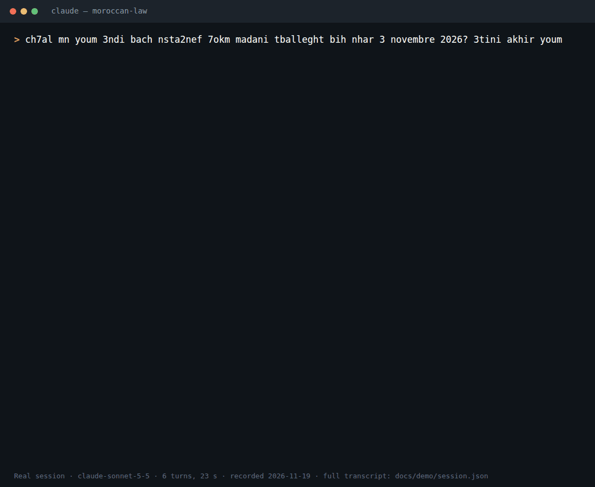

# moroccan-law

**English** · [العربية](README.ar.md) · [Français](README.fr.md)

[](https://github.com/Med-kr/moroccan-law/actions/workflows/ci.yml)
[](skills/maroc-droit/references/catalog-meta.json)
[](LICENSE)

**Moroccan law for Claude and any AI, built from the official texts.** A lawyer asks in Arabic,
French or Darija; the assistant opens the official text, quotes the article word for word with its
number, the date of the version and a link to the source PDF. It does not answer from memory.
**813 texts, 41,410 articles**, as Claude skills, an MCP server for any AI app, and an open dataset.



The recording is a real run ([transcript](docs/demo/session.json)), not a mock-up.

## Does it change anything? Measured

100 fill-in-the-blank questions generated from the texts (a figure removed from one sentence;
the model must give the figure and the article number), same model with and without the plugin:

| Claude Sonnet 5.5, 100 questions, 1 run each | With the plugin | Without |
|---|---|---|
| Figure **and** article number right | **95%** | 7% |
| Figure right | 100% | 48% |
| Article number right | 95% | 9% |

This measures finding and quoting the right provision, not legal reasoning. Method, per-domain
table and limits: [evals/RESULTS.md](evals/RESULTS.md).

## What is inside

- **16 skills, 95 texts, 19,423 articles** from 6,407 pages of official PDFs
  published by the Ministry of Justice ([Adala](https://adala.justice.gov.ma)): 77 texts in
  Arabic (the authoritative language), 15 French versions, 3 repealed texts kept for comparison.
- **An extended corpus of 718 more laws** (`maroc-corpus`, 21,987 articles, 9,003 pages):
  health, education, civil service, agriculture, elections, security, religious affairs, industry,
  energy, territorial authorities, constitutional institutions... Same extraction, article-level
  lookup, but **not reviewed text by text**: automatic quality gates instead. Out of 824 laws, 106
  were left out with their reason (`data/corpus-excluded.json`): no article found (60, mostly
  appointment dahirs), structure not recovered (26), digits garbled by the font, detected as
  impossible dates such as « 62 September » (14), letters read as digits or broken glyphs (5), a table of amounts run together (1). Compared word by word with two other extractors: 99.76% of 1.5 million words and all figures but a handful confirmed (`data/crosscheck-corpus.json`).
  In all: **813 texts, 41,410 articles** with article-level lookup.
- **A catalog of 7,150 official documents** (6,508 Arabic, 642 French): laws, dahirs,
  decrees, orders, ministry circulars, international conventions, Constitutional Court decisions.
  Claude searches it and downloads the official PDF of any of them.
- **Tools for practice** (civil procedure skill):
  - `delais.py` computes a time limit the way article 602 of law 58-25 says, with the public
    holidays of decree 2-77-169;
  - `compare.py` puts an article of the repealed 1974 code next to the closest article of the new
    law 58-25 (computed textual similarity, not an official table);
  - three pleading skeletons in Arabic where every mandatory mention points to its article.
- **An MCP server** (`mcp/server.py`, no dependency) so the same texts work in Claude Desktop,
  Cursor, VS Code and any other MCP client.
- **Provenance for every text**: source URL, portal update date, consolidation date printed in
  the PDF, SHA-256 of the PDF, extraction date, anomalies found while parsing.

| Skill | Domain | Arabic texts (articles) | French versions |
|---|---|---|---|
| `maroc-droit` | Droit marocain — catalogue général | Constitution du Royaume du Maroc (2011) (180) | 1 |
| `maroc-civil` | Droit civil marocain | Dahir formant code des obligations et des contrats (DOC) (1316); Loi 95-17 relative à l'arbitrage et à la médiation conventionnelle (105) | 2 |
| `maroc-procedure-civile` | Procédure civile et organisation judiciaire | Loi 58-25 relative à la procédure civile (644); Loi 38-15 relative à l'organisation judiciaire (111); Loi 42-10 relative aux juridictions de proximité (22); Décret 2-77-169 fixant la liste des jours fériés dans les administrations publiques (3); Dahir relatif à l'exercice de la contrainte par corps en matière civile (3)<br>*Repealed, for comparison:* [ABROGÉ — pour comparaison uniquement] Ancien code de procédure civile (dahir portant loi 1-74-447) (471); [ABROGÉ — pour comparaison uniquement] Loi 41-90 instituant des tribunaux administratifs (47); [ABROGÉ — pour comparaison uniquement] Loi 53-95 instituant des juridictions de commerce (25) | — |
| `maroc-penal` | Droit pénal marocain | Code pénal (731); Loi relative aux peines alternatives (4); Loi relative à la lutte contre les violences faites aux femmes (18); Loi relative à la lutte contre le blanchiment de capitaux (43); Dahir relatif à la répression de la toxicomanie (16); Loi 02-03 relative à l'entrée et au séjour des étrangers et à l'émigration et l'immigration irrégulières (58) | 1 |
| `maroc-procedure-penale` | Procédure pénale | Code de procédure pénale (917) | — |
| `maroc-famille` | Droit de la famille marocain | Code de la famille (Moudawana) (400); Loi 36-21 relative à l'état civil (59); Loi 15-01 relative à la kafala des enfants abandonnés (32); Code de la nationalité marocaine (46) | 2 |
| `maroc-travail` | Droit du travail et protection sociale | Code du travail (loi 65-99) (589); Loi relative à la réparation des accidents du travail (197); Dahir relatif au régime de sécurité sociale (92); Loi 65-00 portant code de la couverture médicale de base (154); Loi organique 97-15 sur le droit de grève (33); Dahir relatif aux syndicats professionnels (27) | 1 |
| `maroc-commerce` | Droit commercial et droit des sociétés | Code de commerce (loi 15-95) (849); Loi 17-95 relative aux sociétés anonymes (461); Loi 5-96 (SNC, SCS, SCA, SARL, société en participation) (147); Loi sur la liberté des prix et de la concurrence (114); Loi édictant des mesures de protection du consommateur (206); Loi 112-12 relative aux coopératives (108) | 4 |
| `maroc-immobilier` | Droit immobilier et baux | Loi 39-08 portant code des droits réels (334); Dahir sur l'immatriculation foncière (134); Loi 18-00 relative au statut de la copropriété des immeubles bâtis (101); Loi sur les baux d'habitation et à usage professionnel (75); Loi sur les baux commerciaux, industriels et artisanaux (38); Loi sur la révision des loyers (10); Loi 7-81 relative à l'expropriation pour cause d'utilité publique (70); Loi 12-90 relative à l'urbanisme (97); Loi 25-90 relative aux lotissements, groupes d'habitations et morcellements (96); Loi 51-00 relative à la location-accession à la propriété immobilière (23); Code des Habous (177) | 3 |
| `maroc-professions-judiciaires` | Profession d'avocat et professions judiciaires | Loi 66-23 organisant la profession d'avocat (147); Loi 32-09 relative à l'organisation de la profession de notaire (134); Loi 51-26 organisant la profession d'adoul (204); Loi 46-21 organisant la profession d'huissier de justice (175); Loi 01-24 relative aux experts judiciaires (77); Loi organique 100-13 relative au Conseil supérieur du pouvoir judiciaire (121); Loi organique 106-13 portant statut des magistrats (118) | — |
| `maroc-administratif` | Droit administratif et marchés publics | Loi 03-01 relative à la motivation des décisions administratives (7); Loi 80-03 instituant des cours d'appel administratives (21); Loi 55-19 relative à la simplification des procédures administratives (33); Loi 54-19 portant charte des services publics (38); Décret 2-22-431 relatif aux marchés publics (170); Loi organique 113-14 relative aux communes (283); Loi 62-99 formant code des juridictions financières (252); Loi 11-03 relative à la protection et à la mise en valeur de l'environnement (80); Loi 36-15 relative à l'eau (164); Loi relative au nantissement des marchés publics (15) | — |
| `maroc-fiscal-douane` | Douanes, recouvrement des créances publiques et fiscalité | Code des douanes et impôts indirects (dahir 1-77-339) (312); Loi 15-97 formant code de recouvrement des créances publiques (152); Loi-cadre 69-19 portant réforme fiscale (19) | — |
| `maroc-numerique` | Données personnelles, transactions électroniques et cybersécurité | Loi 09-08 relative à la protection des données à caractère personnel (67); Loi 53-05 relative à l'échange électronique de données juridiques (4); Loi 43-20 relative aux services de confiance pour les transactions électroniques (84); Loi 05-20 relative à la cybersécurité (53) | 1 |
| `maroc-assurances-banques` | Assurances et banques | Loi 17-99 portant code des assurances (408); Dahir 1-84-177 relatif à l'indemnisation des victimes d'accidents causés par des véhicules terrestres à moteur (32); Loi 103-12 relative aux établissements de crédit et organismes assimilés (233); Loi 40-17 portant statut de Bank Al-Maghrib (81); Loi 52-05 portant code de la route (329) | — |
| `maroc-propriete-intellectuelle` | Propriété intellectuelle et industrielle | Loi 17-97 relative à la protection de la propriété industrielle (293); Loi 2-00 relative aux droits d'auteur et droits voisins (124) | — |
| `maroc-libertes-publiques` | Libertés publiques et presse | Dahir 1-58-376 réglementant le droit d'association (36); Dahir 1-58-377 relatif aux rassemblements publics (26); Loi 88-13 relative à la presse et à l'édition (126); Loi 31-13 relative au droit d'accès à l'information (30) | — |
| `maroc-corpus` | Autres lois marocaines (extraction automatique) | 718 laws and dahirs (21,987 articles), automatic extraction behind quality gates; find them with `law.py find` | — |

Texts and catalog were fetched on 2026-11-19. The date of each consolidated version is in the
skill's `SKILL.md`; some are recent (labour code: 16 July 2026), some are older because that is
what the Ministry publishes.

## Install

**Claude Code** (plugin, one step each):

```text
/plugin marketplace add Med-kr/moroccan-law
/plugin install moroccan-law@moroccan-law
```

or copy the skills without the plugin system: `git clone`, then `./install.sh` (all skills into
`~/.claude/skills`; `./install.sh --list`, `./install.sh maroc-travail`, `--project`).

**Any other AI** (ChatGPT, Gemini, Copilot, Cursor, Windsurf, Codex, LM Studio…): the same texts
through the MCP server (local or over HTTP) or the dataset `exports/moroccan-law-articles.jsonl.gz`
(41,410 articles, one JSON line each). Step-by-step for each app, and the rules to give the AI:
[docs/USE_WITH_ANY_AI.md](docs/USE_WITH_ANY_AI.md).

**Claude Desktop, Cursor, other MCP clients**: clone the repository and add to the client's
MCP configuration:

```json
{ "mcpServers": { "moroccan-law": { "command": "python3", "args": ["/absolute/path/to/moroccan-law/mcp/server.py"] } } }
```

Everything a user runs is standard-library Python 3.10+. Nothing else to install.

## How accurate is the text?

The texts are extracted from PDFs by a program, so they are checked by programs, in four ways
(`scripts/crosscheck.py`, results in `data/crosscheck.json`):

| Check | Arabic (80 texts) | French (15 texts) |
|---|---|---|
| Words compared with a second extractor (poppler) | 943,756 | 317,801 |
| Words the second extractor also produces | 99.88% | 99.98% |
| Words found by neither of two other extractors (poppler, MuPDF) | 301 | 0 |
| Figures (time limits, amounts, article and law numbers) compared | 48,758 | 17,369 |
| Figures found, as written, by neither other extractor | 5 | 1 |
| Footnotes kept (all of them are printed) | 3,979 | 1,202 |

- The 301 words were read one by one: they are ordinary words that the two other extractors cut
  in two. Of the 6 figures, 4 are dahir numbers this project puts back in order on purpose (below).
- **Wrong letters in the source fonts.** A PDF says which letter each glyph stands for, and Word
  sometimes records the wrong one; every extractor then reads the same wrong letter, so comparing
  extractors cannot see it. The build therefore compares each font with the same font in the other
  78 files (`scripts/glyph_table.py`) and corrects the odd one out: 20 glyphs in 15 texts, for
  instance "آ" read as "ا" in the code of civil procedure, "ج" read as "و" in the press code,
  a kashida read as "د" and three letters read as spaces in the public procurement decree.
- **Numbers printed back to front in the source.** Dahir and decree numbers are printed reversed (36 times) in the
  official PDF itself ("11.03.1" for 1.11.03). They are put back in order; `meta.json` counts them.
- Article counts match between the Arabic and French versions of the codes that have both
  (code of obligations 1,316, family code 400, labour code 589, real-rights code 334, Constitution 180).
- **Every note the parser leaves is reviewed** (`scripts/review_anomalies.py`, `data/anomalies-reviewed.json`):
  of 105 notes, 75 are articles repealed by a footnote of the text, 22 are articles of the criminal
  procedure code quoted by the law that inserts them, and 8 were read by hand, with the reason
  written down. A new note fails CI until someone looks at it.
- **Errors printed in the official file itself** are corrected only through a documented erratum
  (`countries/ma/errata.json`, reason in `meta.json`), for instance the labels of articles 353 and
  353 bis swapped in the French PDF of the public limited companies law (the footnotes and the Arabic
  version prove it). A divergence between official versions is shown under the article itself
  (`countries/ma/article_notes.json`): labour code article 256 is in force in the Arabic version
  and marked repealed in the French one.
- **Amendments**: every amending law the portal lists is cited in the consolidated text it amends
  (`scripts/freshness.py`, 0 missing); the weekly job reruns it.

84 automated tests cover the parser, the footnotes, the built skills, the tools, the search, the
legal review set and the MCP server (run on Python 3.10, 3.12 and 3.13).

**This is not a certificate.** No automatic check proves that 1.1 million words are all right.
What can be said: every check above was run on every text, each defect it found was fixed at
its cause and has a test, and the remaining differences were read. For anything that matters,
compare with the PDF (its link is at the top of every text) and with the Bulletin officiel.

## Legal review set

40 questions a practitioner asks, in darija, French and Arabic, across the 16 domains
(`evals/legal/questions.json`). For each one the program checks two things, with no model and no cost:

| Check | Result |
|---|---|
| The expected answer is in the expected article (the set itself is checked against the text) | 40 / 40 |
| The search a careful user would type finds that article in the first 5 results | 40 / 40 |
| ... in the first 3 / first result | 37 / 40 · 34 / 40 |

Writing the set caught two answers written from memory that the texts contradict (custody does not
end at 15: it runs to legal majority, and 15 is the age at which the child chooses, family code art. 166;
an employer declares a work accident within five days, not 48 hours, law 18.12 art. 15). That is the
reason for the rule « never cite from memory ». The search was rebuilt on these questions: ranking by
relevance, attached article and prepositions (« للأطر » / « الأطر »), hamza seats (« بخطإه » / « بخطئه »),
words of the titles, and a short list of doctrinal synonyms checked in the texts (« الشرط الجزائي » →
« التعويض المتفق عليه », DOC 264).

**Held-out set.** Because the search was improved on those 40 questions, 20 more were written
afterwards and never used to tune anything (`evals/legal/holdout.json`): expected answer in the
article **20/20** (after five more answers written from memory were corrected from the texts, for
instance the time limit for opposition to a default judgment is 15 days, art. 200 of law 58.25),
right article in the first 5 results **17/20**, first result **13/20**. That is the honest figure
for one search; Claude usually runs several. A third set of 40 questions (`holdout2.json`), written
before a second round of search changes and measured once after it: top 5 **31/40** before and after,
first result 22 → 23/40. Keyword search is at its ceiling on these texts; semantic search is next.

This measures the texts and the search, not the legal reasoning. [docs/LAWYER_REVIEW.md](docs/LAWYER_REVIEW.md)
is the same set as a sheet for a practising lawyer to grade Claude's answers; filled sheets are welcome.

## Limits

- **Automatic extraction.** A few words carry a stray space, tables are flattened, and some
  headings are kept as plain text (listed under `anomalies` in each `meta.json`). Before filing
  anything in court, check the quotation against the official PDF or the Bulletin officiel.
- **French versions are often older** than the Arabic ones (French labour code: 2011; Arabic:
  2026). They are labelled as such and the skills tell Claude to compare the dates. Arabic prevails.
- **Case law**: only Constitutional Court decisions, as PDFs through the catalog. The official
  portal of the CSPJ (juriscassation.cspj.ma: about 52,000 Court of Cassation decisions) asks for a
  confirmation code before showing a decision, so it is not crawled: the skills send the user there
  with Arabic search words and analyse a decision pasted in the conversation. They never cite a
  decision from memory. An open-data agreement with the CSPJ would lift this limit.
- **Not on the portal, so not here**: the General Tax Code (CGI); the tax administration's site
  refuses automated access. The finance laws are on the portal in the two-column layout of the
  Bulletin officiel; the extractor now reads two columns in order, but the fonts of those files map
  some letters to digits (« ك » read « 6 », « ر » read « 7 », 291 times in the 2026 law, the same digit
  standing for different letters), so rates and amounts could be wrong: they are left out. Customs, public-debt recovery and the tax-reform framework law are included.
- **813 texts have article-level lookup** (95 reviewed, 718 in the extended corpus); decrees, orders and the rest of the catalog are one download away as PDF.
- **Up to date as of the build date.** A weekly GitHub Action refreshes the catalog and opens an
  issue when a bundled text is replaced on the portal; it has been tested locally but has not
  yet run on GitHub.
- **Time limits**: `delais.py` applies article 602 of law 58.25, the fixed-date holidays of decree
  2.77.169 and article 639 (platform down on the last day). Religious holidays are estimated
  (tabular Hijri calendar, which matched every date announced in 2024-2025) and only trigger a
  warning: the moon sighting decides. The time limit starting afresh after a suspension (article 212: change of capacity; article 380: legal aid) is computed with `--restart`.
- **Application in time**: `law.py transitional <text>` prints the transitional and final
  provisions; the skills must read them when the facts may predate a reform.

## Other countries

The pipeline is not specific to Morocco: a country is a folder under `countries/` (source,
list of texts, wording of the skills), and a text can be listed by a direct PDF URL. Arabic and
French numbering conventions are handled. Morocco is the only country implemented so far.
See [docs/ADDING_A_COUNTRY.md](docs/ADDING_A_COUNTRY.md).

## Build and update

```bash
npm ci                                                    # pdf.js
python3 sources/adala.py --out data/catalog.json          # refresh the catalog
uv run --with pymupdf python scripts/build.py --check     # which bundled texts changed
uv run --with pymupdf python scripts/build.py             # rebuild (needs node and poppler-utils)
uv run --with pymupdf python scripts/crosscheck.py        # compare with a second extractor
python3 -W ignore -m unittest discover -s tests
```

Extraction handles mirrored lam-alef ligatures, reading order rebuilt from glyph positions,
footnotes attached to their article, numbering checked against the sequence, and two kinds of
faulty font tables found in the source files. Details are in the docstrings of `scripts/`.

## Disclaimer

A research and drafting aid for legal professionals. It is not legal advice and does not replace
a lawyer. The project is independent: it is not affiliated with, or endorsed by, the Ministry of
Justice, the Secrétariat général du gouvernement, or Anthropic. The only authentic source of
Moroccan law is the Bulletin officiel.

## Contributing and license

See [CONTRIBUTING.md](CONTRIBUTING.md). Code and documentation: [MIT](LICENSE). The legal texts
are official texts of the Kingdom of Morocco reproduced from Adala; this project claims no
rights over them.
